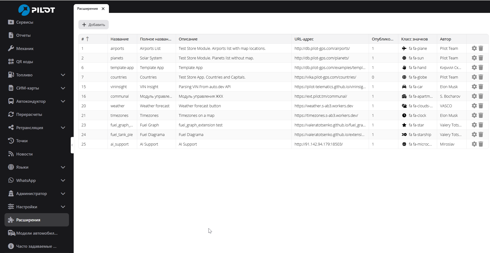
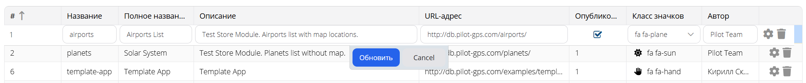
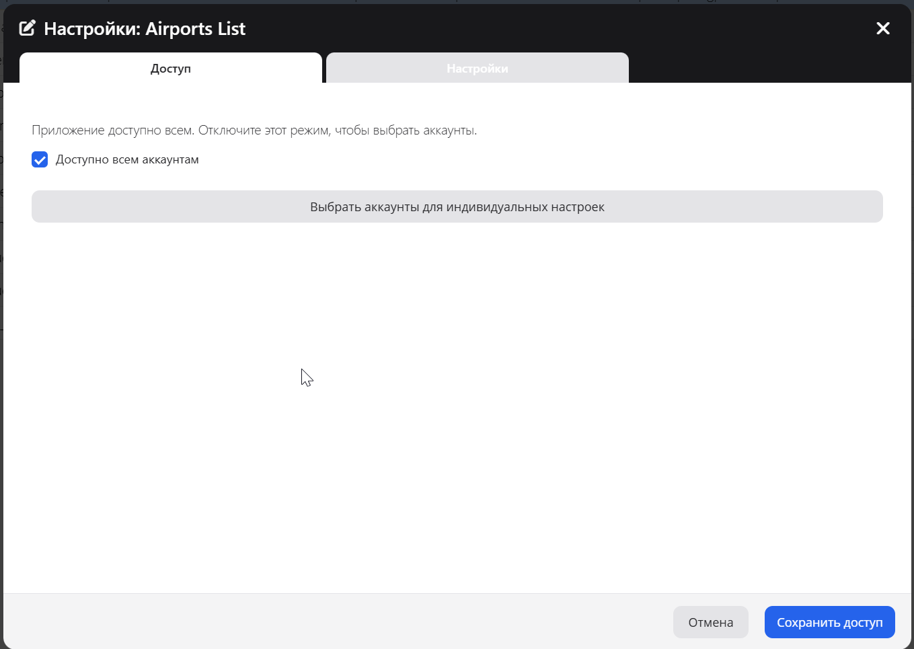
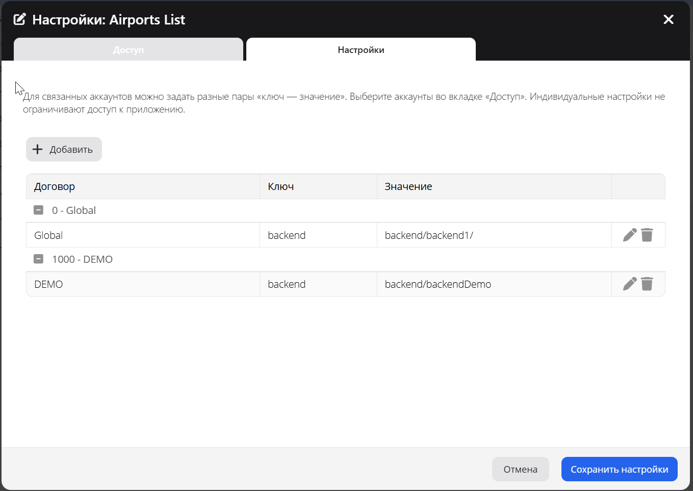
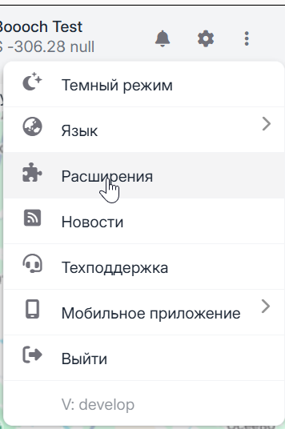
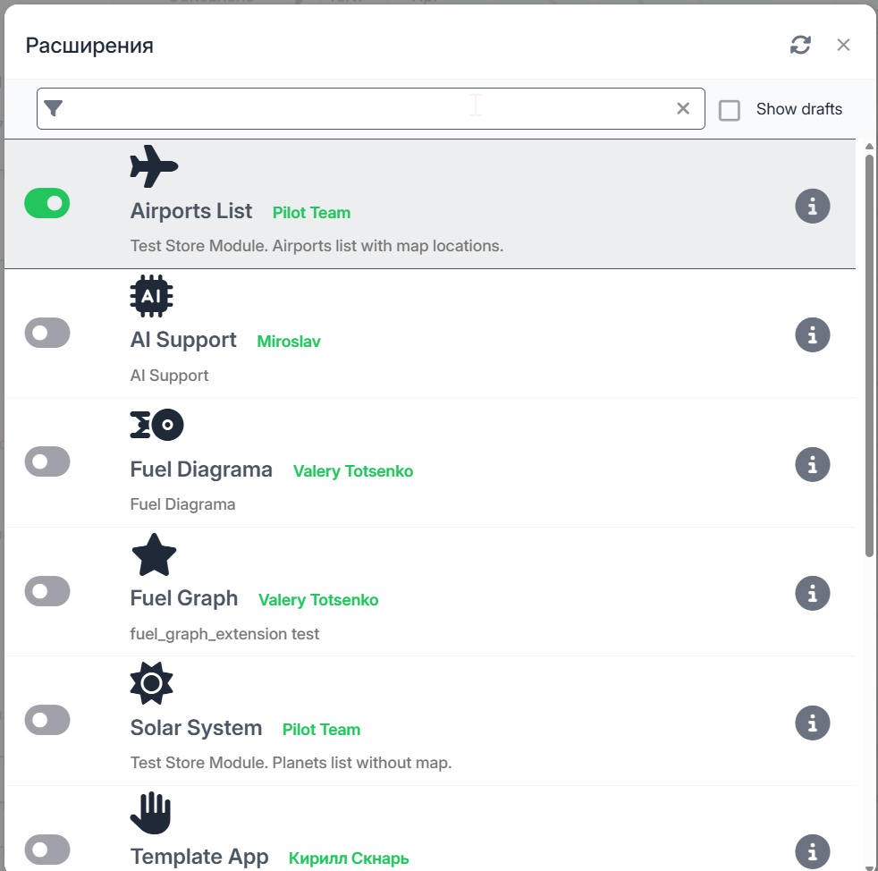

# Register and Enable a PILOT Extension

This guide explains how to register a hosted Extension in Admin, grant account access, set Extension settings, and enable the Extension in PILOT.

For hosting instructions, see [the deployment guide](../DEPLOY.md). For Extension development, see [the developer guide](HUMAN_EXTENSION_GUIDE.md).

## Before you start

1. Host the Extension files at a public base URL.
2. Open the Extension entry file directly at `<base-url>/Module.js`. Confirm that the browser shows JavaScript source and not an error page.
3. Use the same lowercase `snake_case` name in Admin and in the Ext JS class name. For example, the name `weather_demo` requires `Store.weather_demo.Module`.
4. Use the base URL in Admin. Do not enter the `Module.js` URL as the base URL. A trailing slash is recommended.

Example:

| Purpose | URL |
|---|---|
| Verify the entry file | `https://example.com/weather_demo/Module.js` |
| Register in Admin | `https://example.com/weather_demo/` |

## Register the Extension in Admin

1. Sign in to Admin.
2. Open **Extensions** in the left menu. This opens the **Extensions** list.
3. Select **Add**.
4. Edit the new row and enter these fields:

| Field | Value |
|---|---|
| **Name** | Technical Extension name in lowercase `snake_case`, such as `weather_demo`. It must match the class name in `Module.js`. |
| **Name Pretty** | Name shown to PILOT users. |
| **Description** | Short description shown in PILOT. |
| **URL** | Hosted base URL, such as `https://example.com/weather_demo/`. |
| **Is Published** | Select this when users can see and enable the Extension. |
| **Icon class** | Select an icon for the Extension. |
| **Author** | Name shown as the Extension author. |

5. Select **Update** to save the row. Admin checks the URL. Confirm that the URL is accepted and that the entry appears in the Extensions list.

**Note:** **Add** creates a record before row editing is complete. If you abandon a new entry, check the list and remove the unused record with its delete action.

## Grant access to accounts

1. In the **Extensions** list, select the gear icon on the Extension row.
2. Open the **Access** tab.
3. Choose one access mode:
   - Leave **Available to all accounts** selected to grant access to all accounts.
   - Clear it to select the accounts that can use the Extension. Mark each required account as available.
4. Select **Save access**.

Access controls whether an account can see and use an Extension. An Extension appears in PILOT only when it is published and available to the current account.

To set account-specific values while keeping the Extension available to all accounts, leave **Available to all accounts** selected. Then select **Choose accounts for individual settings** and link the accounts that need their own values. This list does not change who can access the Extension.

## Set global or account-specific settings

1. Open the Extension settings window from the gear icon.
2. Select the **Settings** tab.
3. Select **Add**.
4. Choose **Global** or a linked account.
5. Enter a key and value. Repeat for each setting.
6. Select **Save settings**.

Global settings apply as defaults. Account settings override global values with the same key. Link an account in **Access** before you add settings for it.

Values returned to Extension JavaScript are available in the browser. Do not store passwords, private keys, or other secrets in these settings. Use server-side configuration for secrets. See [the runtime settings API](PILOT_RUNTIME_UTILS.md#extension-settings-api).

## Enable the Extension in PILOT

1. Sign in to PILOT with a user from an account that has Extension access.
2. Open the top-right menu.
3. Select **Extensions**.
4. Find the Extension in the list.
5. Turn on its active switch.
6. Close the window or select the Extension from the PILOT menu. Reload PILOT if the Extension does not appear.

The Extensions list shows the Extensions available to the current account. The active switch controls whether the Extension is loaded for the current PILOT user.

## Troubleshooting

| Problem | Check |
|---|---|
| Extension is missing from the PILOT list | Confirm that **Is Published** is selected and that the current account has access. |
| Extension appears but does not load | Confirm that the Admin name matches `Store.<name>.Module` in `Module.js`. Check the base URL and confirm that `Module.js` opens directly. |
| Changes do not appear | Reload PILOT, then reopen **Extensions**. |
| Account setting cannot be added | Link the account in the **Access** tab first. |
| Extension cannot reach its backend | Use the same-origin `/store/<extension>/backend/` proxy path. See [the deployment guide](../DEPLOY.md). |

## Related guides

- [Deployment and hosting](../DEPLOY.md)
- [PILOT Extension developer guide](HUMAN_EXTENSION_GUIDE.md)
- [Runtime settings API](PILOT_RUNTIME_UTILS.md)
- [API compatibility and support boundaries](PILOT_API_COMPATIBILITY.md)
