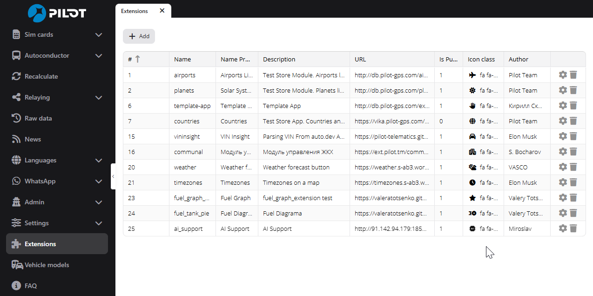
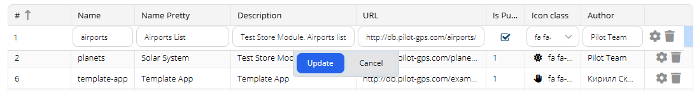
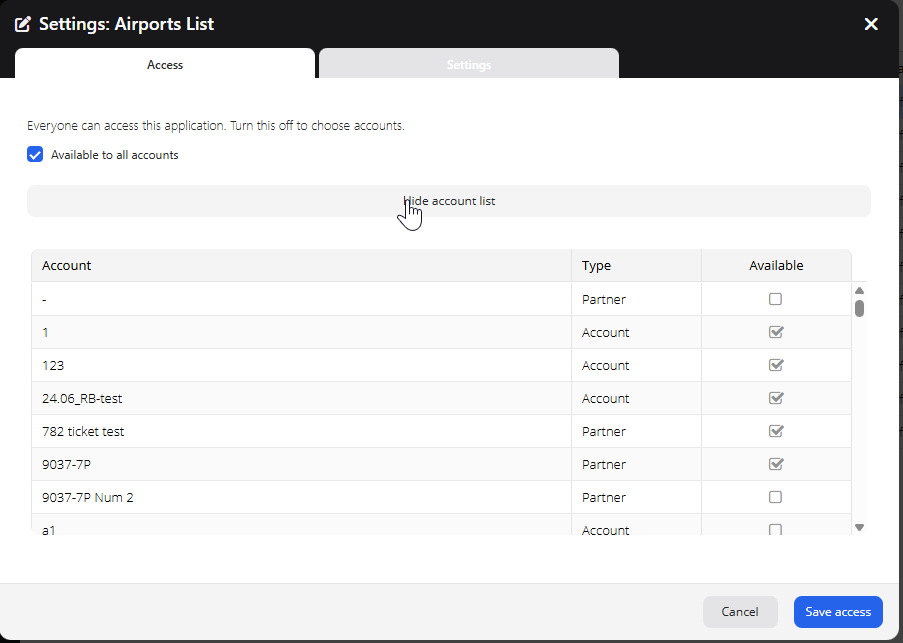
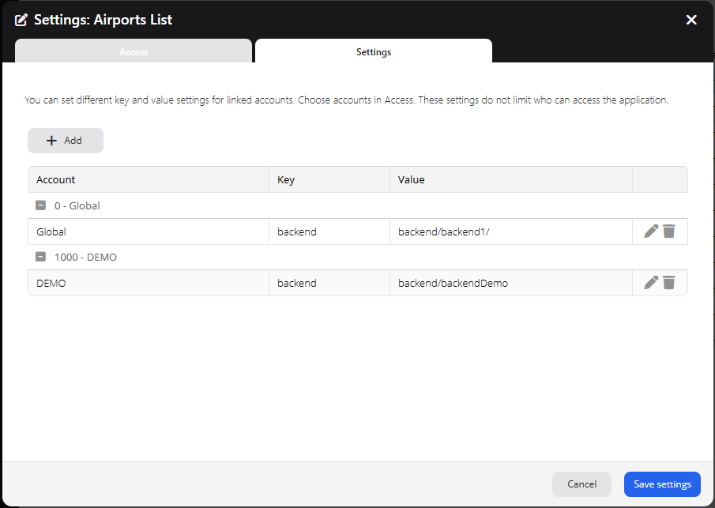
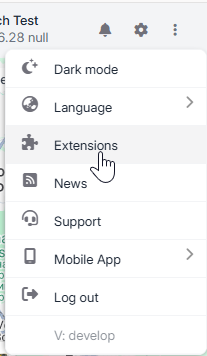
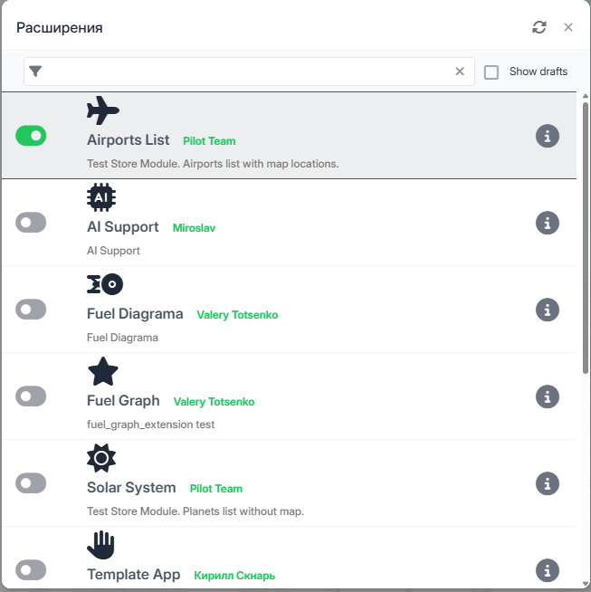

# Регистрация и включение PILOT Extension

Это руководство описывает, как зарегистрировать размещённый Extension в Admin, выдать доступ аккаунтам, задать настройки и включить Extension в PILOT.

Инструкции по размещению файлов см. в [руководстве по публикации](../DEPLOY.md). О разработке Extension см. [руководство разработчика](HUMAN_EXTENSION_GUIDE_RU.md).

## Перед началом

1. Разместите файлы Extension по публичному базовому URL.
2. Откройте файл входа Extension напрямую по адресу `<base-url>/Module.js`. Убедитесь, что браузер показывает исходный JavaScript, а не страницу ошибки.
3. Используйте одно и то же имя в формате lowercase `snake_case` в Admin и в имени класса Ext JS. Например, имя `weather_demo` требует класс `Store.weather_demo.Module`.
4. В Admin указывайте базовый URL. Не указывайте URL самого файла `Module.js`. Рекомендуется завершать URL символом `/`.

Пример:

| Назначение | URL |
|---|---|
| Проверить файл входа | `https://example.com/weather_demo/Module.js` |
| Зарегистрировать в Admin | `https://example.com/weather_demo/` |

## Зарегистрируйте Extension в Admin

1. Войдите в Admin.
2. В левом меню откройте **Extensions**. Откроется список **Applications**.
3. Нажмите **Add**.
4. Заполните поля новой строки:

| Поле | Что указать |
|---|---|
| **Name** | Техническое имя Extension в lowercase `snake_case`, например `weather_demo`. Оно должно совпадать с именем класса в `Module.js`. |
| **Name Pretty** | Имя, которое увидят пользователи PILOT. |
| **Description** | Краткое описание Extension. |
| **URL** | Базовый URL размещения, например `https://example.com/weather_demo/`. |
| **Is Published** | Включите, чтобы пользователи могли увидеть и включить Extension. |
| **Icon class** | Выберите значок Extension. |
| **Author** | Укажите имя автора, которое будет показано пользователям. |

5. Нажмите **Update**, чтобы сохранить строку. Admin проверяет URL. Убедитесь, что URL прошёл проверку и запись появилась в списке Applications.

**Важно:** **Add** создаёт запись до завершения редактирования строки. Если вы отменили создание, проверьте список и удалите ненужную запись действием удаления.

## Выдайте доступ аккаунтам

1. В списке **Applications** нажмите значок шестерёнки в строке Extension.
2. Откройте вкладку **Access**.
3. Выберите режим доступа:
   - Оставьте **Available to all accounts** включённым, чтобы выдать доступ всем аккаунтам.
   - Выключите этот параметр, чтобы выбрать аккаунты, которым доступен Extension. Отметьте нужные аккаунты.
4. Нажмите **Save access**.

Настройки доступа определяют, увидит ли аккаунт Extension и сможет ли его использовать. Extension отображается в PILOT, если он опубликован и доступен текущему аккаунту.

Чтобы задать отдельные значения для некоторых аккаунтов, оставив Extension доступным всем, не выключайте **Available to all accounts**. Затем нажмите **Choose accounts for individual settings** и добавьте аккаунты, которым нужны собственные значения. Этот список не ограничивает доступ к приложению.

## Задайте глобальные настройки или настройки аккаунта

1. Откройте окно настроек Extension через значок шестерёнки.
2. Выберите вкладку **Settings**.
3. Нажмите **Add**.
4. Выберите **Global** или связанный аккаунт.
5. Введите ключ и значение. Повторите для каждой настройки.
6. Нажмите **Save settings**.

Глобальные настройки задают значения по умолчанию. Настройки аккаунта заменяют глобальные значения с теми же ключами. Перед добавлением настроек свяжите аккаунт во вкладке **Access**.

Значения, которые возвращает JavaScript Extension, доступны в браузере. Не храните в этих настройках пароли, приватные ключи и другие секреты. Для секретов используйте серверную конфигурацию. Подробности см. в [справочнике настроек runtime](PILOT_RUNTIME_UTILS_RU.md#api-настроек-extension).

## Включите Extension в PILOT

1. Войдите в PILOT под пользователем аккаунта, которому выдали доступ.
2. Откройте меню в правом верхнем углу.
3. Выберите **Extensions**.
4. Найдите Extension в списке.
5. Включите переключатель активности.
6. Закройте окно или выберите Extension в меню PILOT. Если Extension не появился, перезагрузите PILOT.

В списке Extensions отображаются приложения, доступные текущему аккаунту. Переключатель активности определяет, загружать ли Extension для текущего пользователя PILOT.

## Если что-то не работает

| Проблема | Что проверить |
|---|---|
| Extension отсутствует в списке PILOT | Убедитесь, что включён **Is Published** и что текущий аккаунт имеет доступ. |
| Extension появился, но не загружается | Проверьте, что имя в Admin совпадает с `Store.<name>.Module` в `Module.js`. Проверьте базовый URL и откройте `Module.js` напрямую. |
| Изменения не видны | Перезагрузите PILOT и снова откройте **Extensions**. |
| Не удаётся добавить настройку аккаунта | Сначала свяжите аккаунт во вкладке **Access**. |
| Extension не подключается к backend | Используйте same-origin proxy `/store/<extension>/backend/`. См. [руководство по публикации](../DEPLOY.md). |

## Связанные руководства

- [Размещение и публикация](../DEPLOY.md)
- [Руководство разработчика PILOT Extension](HUMAN_EXTENSION_GUIDE_RU.md)
- [API настроек runtime](PILOT_RUNTIME_UTILS_RU.md)
- [Совместимость API и границы поддержки](PILOT_API_COMPATIBILITY_RU.md)
